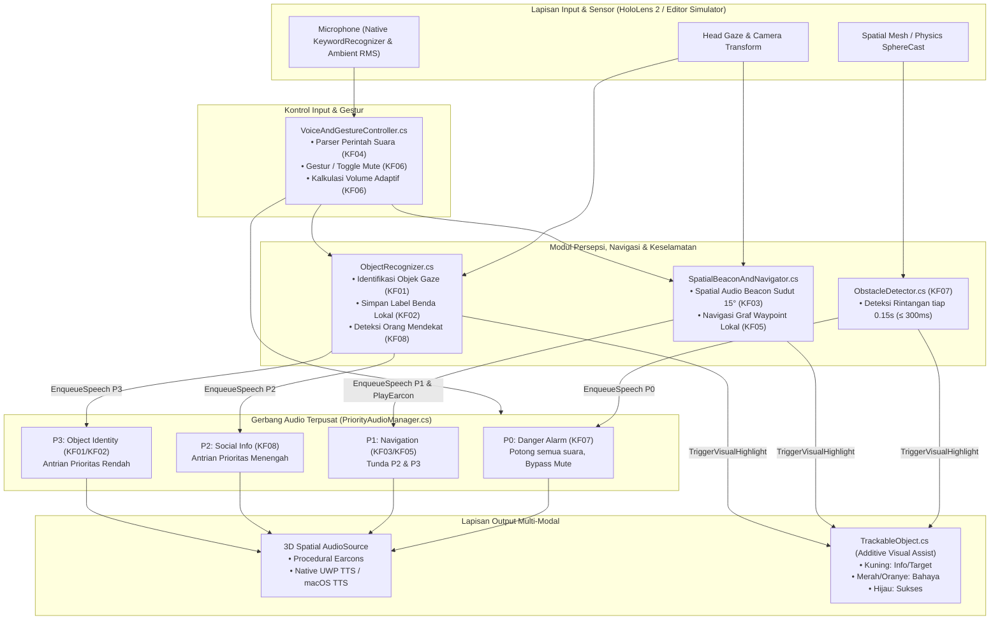

# By Your Sight — Interactive Mixed Reality Prototype (HoloLens 2)

**By Your Sight** adalah prototipe aplikasi Mixed Reality / AR asistif berbasis **Unity 2022.3 LTS (URP + OpenXR)** untuk **Microsoft HoloLens 2** yang dirancang sebagai pendamping navigasi ruang dan pengenalan objek berbasis *3D Spatial Audio* bagi penyandang tunanetra dan *low-vision*.

Nama **"By Your Sight"** memiliki makna ganda: *"By Your Side"* (selalu mendampingi di sisi pengguna) sekaligus *"By Your Sight"* (menguatkan sisa penglihatan pengguna melalui kombinasi *audio-first* dan *high-contrast visual-assist*).

---

## Daftar Isi
1. [Prinsip Desain & Hierarki Prioritas Audio (T3)](#1-prinsip-desain--hierarki-prioritas-audio-t3)
2. [Penyesuaian Teknis dari Dokumen Rancangan T3](#2-penyesuaian-teknis-dari-dokumen-rancangan-t3)
3. [Fitur Tambahan pada Implementasi Prototipe](#3-fitur-tambahan-pada-implementasi-prototipe)
4. [Arsitektur Sistem](#4-arsitektur-sistem)
5. [Struktur Kode & Pemetaan Kebutuhan Fungsional (KF01–KF08)](#5-struktur-kode--pemetaan-kebutuhan-fungsional-kf01kf08)
6. [Kosakata Perintah Suara (Native HoloLens 2)](#6-kosakata-perintah-suara-native-hololens-2)
7. [Cara Menjalankan & Menguji di Unity Editor](#7-cara-menjalankan--menguji-di-unity-editor)

---

## 1. Prinsip Desain & Hierarki Prioritas Audio (T3)

Sesuai spesifikasi desain pada dokumen **Milestone 3 (T3)**, aplikasi ini menerapkan prinsip:
- **Audio-first, visual-assist:** Seluruh informasi wajib tersedia melalui audio spasial, sedangkan lapisan visual kontras tinggi pada layar *additive* HoloLens berfungsi sebagai penguat bagi pengguna *low-vision* (Kuning = Info/Target, Merah/Oranye = Bahaya, Hijau = Sukses).
- **Singkat dulu, detail jika diminta:** Pola kalimat tetap **`[What] + [Distance] + [Direction]`** (maksimal 6–8 kata, menggunakan arah relatif tubuh: *ahead*, *slightly right*, *right*, *slightly left*, *left*, *behind*). Detail tambahan hanya diucapkan jika pengguna meminta `"Details"`.
- **Jangan menutupi suara lingkungan:** Volume beradaptasi terhadap kebisingan sekitar (KF06) dan mendukung perintah/gestur *Mute* cepat.
- **Keselamatan di atas segalanya:** Seluruh output suara melewati satu antrian prioritas terpusat (`PriorityAudioManager`):

| Prioritas | Jenis Informasi | Contoh Output Suara | Perilaku Antrian |
| :--- | :--- | :--- | :--- |
| **P0** | Alarm Bahaya (KF07) | *"Warning! Pillar, 1 meter, ahead"* | Memotong semua suara lain seketika, **tidak bisa di-mute**, disertai *double-beep* tajam. |
| **P1** | Instruksi Navigasi & Beacon (KF03, KF05) | *"Turn left, 2 meters"* / *"Straight ahead, 2 meters"* | Menunda pesan **P2** dan **P3**; memperbarui instruksi rute terbaru. |
| **P2** | Informasi Sosial (KF08) | *"Person approaching, right"* | Diantrikan di bawah P0 & P1; menjaga privasi tanpa menyimpan identitas wajah. |
| **P3** | Identifikasi Objek & Konfirmasi (KF01, KF02) | *"Water bottle, 1.5 meters, ahead"* | Diantrikan paling akhir; dapat dibisukan (*mute*) kapan saja oleh pengguna. |

---

## 2. Penyesuaian Teknis dari Dokumen Rancangan T3

Berdasarkan evaluasi *Technical Constraints* pada dokumen T3 terkait keterbatasan perangkat keras **Microsoft HoloLens 2** (prosesor ARM64 Qualcomm Snapdragon 850 dan tidak tersedianya Bahasa Indonesia pada sistem operasi bawaan *Windows Holographic OS*), dilakukan penyesuaian berikut:

| Aspek pada Dokumen T3 | Rancangan Awal di T3 | Implementasi Final (`ByYourSight`) | Alasan Teknis & Optimasi Komputasi |
| :--- | :--- | :--- | :--- |
| **Mesin Speech-to-Text (KF04) & TTS** | Menggunakan **Azure Speech Cloud (`id-ID`)** yang membutuhkan koneksi internet aktif. | Diubah ke **100% Native Offline HoloLens 2**: `KeywordRecognizer` (`UnityEngine.Windows.Speech`) & `SpeechSynthesizer` (`Windows.Media.SpeechSynthesis`). | Diproses langsung oleh co-processor/DSP bawaan HoloLens 2 (beban CPU hampir 0%), bebas latensi jaringan Wi-Fi, tidak menguras baterai/memicu *thermal throttling*, dan bebas masalah kompatibilitas DLL Azure pada ARM64. |
| **Kosakata Perintah Suara (KF04)** | Bahasa Indonesia (*"Ini apa?"*, *"Simpan benda"*, *"Cari [benda]"*, *"Antar ke [tujuan]"*, *"Diam"/"Lanjut"*, *"Ulangi"*, *"Detail"*, *"Bantuan"*, *"Batal"*). | Bahasa Inggris Native (*"What is this?"*, *"Save object"*, *"Find [item]"*, *"Navigate to [dest]"*, *"Mute"/"Resume"*, *"Repeat"*, *"Details"*, *"Help"*, *"Cancel"*). | Mengikuti bahasa yang didukung secara *native* dan *offline* oleh Windows Speech API di HoloLens 2. |
| **Pola Kalimat Output TTS** | Bahasa Indonesia dengan pola `[Apa] + [Jarak] + [Arah]` (≤ 6–8 kata, arah tubuh). | Struktur kalimat **tetap sama persis** sesuai Design System T3 dalam Bahasa Inggris: `[What] + [Distance] + [Direction]`. | Mempertahankan konsistensi aturan kognitif dan *Design System* T3 dalam bahasa *native* perangkat. |

---

## 3. Fitur Tambahan pada Implementasi Prototipe

Untuk mendukung pengujian *usability* dan simulasi *Wizard of Oz* sebagaimana direncanakan pada dokumen T3, implementasi ini menambahkan:

1. **Synthesizer Earcon Prosedural (`PriorityAudioManager.PlayEarcon`):**
   - Menghasilkan 4 jenis *earcon* sesuai spesifikasi T3 (*Listening Start/End*, *Success/Failure* dengan nada naik/turun, *Spatial Beacon* yang berubah frekuensi & *pitch*, serta *Danger Alarm* berupa *double-beep* tajam) secara matematika di C# tanpa ketergantungan file `.wav` eksternal.
2. **Cross-Platform TTS Fallback (UWP HoloLens 2 & macOS Editor):**
   - Menggunakan `Windows.Media.SpeechSynthesis` secara *native* saat di-*build* ke UWP HoloLens 2 (`WINDOWS_UWP`), serta otomatis beralih menggunakan synthesizer suara *Samantha* bawaan macOS (`UNITY_EDITOR_OSX`) saat diuji di laptop Mac.
3. **Simulator *Wizard of Oz* & Pengujian Constraint T3 (`VoiceAndGestureController.OnGUI`):**
   - Kontrol pergerakan ruangan (`WASD`) dan rotasi pandangan kepala (`Q`/`E` atau klik kanan *mouse*) di Unity Editor.
   - Simulasi kondisi **cahaya redup** (`simulateLowLightWarning` untuk menguji respons *"Not sure, low light. Move closer to the object"*).
   - *Slider* **Ambient Noise RMS** untuk menguji adaptasi volume otomatis (KF06).
   - Tombol pemicu **Approaching Person** untuk menyimulasikan orang berjalan mendekati pengguna (KF08).
4. **One-Click Indoor Scene Builder (`ByYourSightSceneSetup.cs`):**
   - Menu kustom di Unity Editor (`By Your Sight > Setup Demo Prototype Scene (KF01 - KF08)`) yang membangun lingkungan ruangan indoor lengkap dengan objek sehari-hari, rintangan tiang/kursi, karakter orang sekitar, dan graf *waypoint* lokal menuju Pintu serta Meja.

---

## 4. Arsitektur Sistem

Seluruh modul persepsi, navigasi, dan keselamatan tidak membunyikan speaker secara langsung, melainkan mengirim permintaan ke gerbang audio terpusat (`PriorityAudioManager`) agar tidak terjadi tabrakan suara antar-fitur:

---

## 5. Struktur Kode & Pemetaan Kebutuhan Fungsional (KF01–KF08)

Seluruh skrip berada di direktori `Assets/Scripts/`:

- `Assets/Scripts/Audio/PriorityAudioManager.cs`
  - Mengelola antrian prioritas audio (`P0`–`P3`), *cooldown* alarm bahaya, status *Mute* (KF06), fitur *"Repeat"* & *"Details"*, *synthesizer earcon* prosedural, kalkulasi arah relatif tubuh, serta *engine* TTS *native* UWP & macOS.
- `Assets/Scripts/Perception/TrackableObject.cs`
  - Komponen metadata objek (`EverydayObject`, `HazardObstacle`, `Person`) beserta sistem *high-contrast visual highlight* dan **3D Thick Bounding Box Outline (`LineRenderer`)** untuk layar *additive* HoloLens.
- `Assets/Scripts/Perception/ObjectRecognizer.cs`
  - **KF01 (`IdentifyObjectInGaze`):** Mengidentifikasi objek di arah pandang kepala dengan format `[What] + [Distance] + [Direction]`.
  - **KF02 (`SaveCustomObjectInGaze`):** Menyimpan objek di arah pandang dengan label suara kustom milik pengguna.
  - **KF08 (`MonitorApproachingPeople`):** Mendeteksi orang yang bergerak mendekati pengguna pada jarak `1.0m–3.0m` (`100 cm–300 cm`) dan memicu info sosial `P2`.
- `Assets/Scripts/Navigation/SpatialBeaconAndNavigator.cs`
  - **KF03 (`StartBeaconForObject` & `UpdateSpatialBeacon`):** Memandu pengguna memutar kepala menuju objek yang dicari menggunakan *3D Spatial Audio Beacon* (frekuensi ketukan makin cepat dan nada makin tinggi saat sudut kepala mendekati 0°, dengan konfirmasi saat masuk toleransi **15°**).
  - **KF05 (`StartNavigationTo` & `UpdateWaypointNavigation`):** Memandu pengguna berjalan mengikuti rute *waypoint* lokal menuju tujuan (*Door* atau *Desk*) dengan instruksi pergantian arah pada jarak `1.0m` (`100 cm`) sebelum titik belok berprioritas `P1`.
- `Assets/Scripts/Safety/ObstacleDetector.cs`
  - **KF07 (`CheckObstaclesAhead`):** Melakukan `SphereCast` horizontal setiap `0.15` detik (memenuhi target latensi `< 300ms`) untuk mendeteksi rintangan bahaya pada jarak `< 1.5m` (`150 cm`) di jalur jalan pengguna dan memicu alarm `P0`.
- `Assets/Scripts/Input/VoiceAndGestureController.cs`
  - **KF04 & KF06:** Mengintegrasikan `KeywordRecognizer` *native* HoloLens 2, memproses perintah suara bahasa Inggris, mengatur adaptasi volume berdasarkan kebisingan lingkungan, dan menyediakan HUD simulator di Unity Editor.
- `Assets/Scripts/Editor/ByYourSightSceneSetup.cs`
  - Skrip otomatis Unity Editor untuk membangun seluruh *environment* dan komponen prototipe dalam satu klik.

---

## 6. Kosakata Perintah Suara (Native HoloLens 2)

| Perintah Suara (English) | Pintasan Keyboard (Editor) | Fungsi Terkait | Contoh Respons Sistem |
| :--- | :---: | :--- | :--- |
| **"What is this?"** / **"Identify"** | `1` | KF01 (Identifikasi Objek) | *"Water bottle, 1.5 meters, ahead"* |
| **"Save object [label]"** | `2` | KF02 (Simpan Benda) | *"Saved, House Keys"* |
| **"Find Water bottle"** | `3` | KF03 (Spatial Audio Beacon) | *"Water bottle, 2 meters, ahead. Turn your head"* |
| **"Find Coffee mug"** | `4` | KF03 (Spatial Audio Beacon) | *"Coffee mug, 2.5 meters, slightly right. Turn your head"* |
| **"Navigate to Door"** / **"Take me to the door"** | `5` | KF05 (Navigasi Waypoint) | *"Navigating to Door"* → *"Go straight, 3 meters"* |
| **"Navigate to Desk"** / **"Take me to the desk"** | `6` | KF05 (Navigasi Waypoint) | *"Navigating to Desk"* → *"Bear right, 2 meters"* |
| **"Repeat"** | `7` | Prinsip Desain T3 | Mengulangi kalimat singkat terakhir. |
| **"Details"** | `8` | Prinsip Desain T3 | Membacakan deskripsi detail objek terakhir. |
| **"Cancel"** / **"Stop"** | `9` | Kontrol Navigasi/Beacon | *"Guidance cancelled"* |
| **"Mute"** / **"Quiet"** / **"Resume"** | `M` | KF06 (Kontrol Audio Cepat) | Membisukan P1–P3 (P0 tetap aktif) / *"Audio resumed"* |
| **"Help"** | — | Panduan Pengguna | *"Say: What is this, Find item, Navigate to door, or Mute"* |

---

## 7. Cara Menjalankan & Menguji di Unity Editor

1. Buka folder `ByYourSight` menggunakan **Unity Hub** (Unity versi **2022.3 LTS**).
2. Buka scene `Assets/Scenes/SampleScene.unity`.
3. **Setup Ruangan Otomatis:**
   - Begitu Unity selesai melakukan *compile*, scene akan **otomatis terisi** dengan `ByYourSight_PrototypeEnvironment` dan `ByYourSight_CoreSystem`.
   - Jika ingin me-*reset* ulang ruangan kapan saja, cukup **Klik Kanan** pada panel **Hierarchy** (di sebelah kiri layar Unity) lalu pilih **`By Your Sight - Setup Prototype Scene`**.
4. Klik tombol **Play (▶)** di bagian tengah atas Unity Editor, lalu ikuti langkah pengujian berikut:
   - **Berjalan di Ruangan:** Gunakan tombol **`W` `A` `S` `D`**.
   - **Memutar Pandangan Kepala (*Head Gaze*):** Tekan tombol **`Q` / `E`** atau tahan **Klik Kanan Mouse** sambil menggeser *mouse*. Arahkan tanda **`+` kuning** di tengah layar ke objek.
   - **Menguji Fitur KF01–KF08:** Klik tombol pada panel **By Your Sight — HoloLens Native (EN)** di pojok kiri layar *Game* (atau tekan tombol angka **`1`–`9`** dan **`M`** di keyboard).
