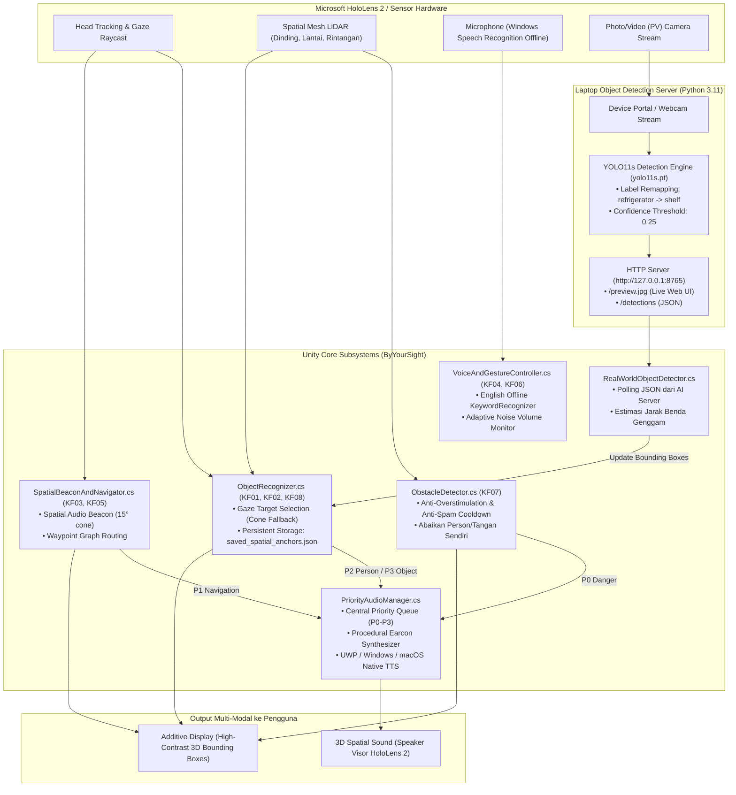

# By Your Sight — Interactive Mixed Reality Prototype (HoloLens 2)

**By Your Sight** adalah prototipe aplikasi Mixed Reality / AR asistif berbasis **Unity 2022.3 LTS (URP + OpenXR)** untuk **Microsoft HoloLens 2** yang dirancang sebagai pendamping navigasi ruang dan pengenalan objek berbasis *3D Spatial Audio* bagi penyandang tunanetra dan *low-vision*.

Nama **"By Your Sight"** memiliki makna ganda: *"By Your Side"* (selalu mendampingi di sisi pengguna) sekaligus *"By Your Sight"* (menguatkan sisa penglihatan pengguna melalui perpaduan *audio-first* dan *high-contrast visual-assist*).

---

## Daftar Isi
1. [Prinsip Desain & Hierarki Prioritas Audio](#1-prinsip-desain--hierarki-prioritas-audio-t3)
2. [Arsitektur Sistem Terpadu](#2-arsitektur-sistem-terpadu)
3. [Prasyarat & Persiapan Lingkungan](#3-prasyarat--persiapan-lingkungan)
4. [Setup & Menjalankan AI Detection Server (YOLO)](#4-setup--menjalankan-ai-detection-server-yolo)
5. [Menjalankan & Menguji di Unity Editor (Play Mode)](#5-menjalankan--menguji-di-unity-editor-play-mode)
6. [Panduan Deployment ke Microsoft HoloLens 2](#6-panduan-deployment-ke-microsoft-hololens-2)
7. [Fitur Persepsi & Spatial Anchoring Permanen](#7-fitur-persepsi--spatial-anchoring-permanen)
8. [Kosakata Lengkap Perintah Suara (Voice Commands)](#8-kosakata-lengkap-perintah-suara-voice-commands)
9. [Struktur Kode & Pemetaan Modul (KF01–KF08)](#9-struktur-kode--pemetaan-modul-kf01kf08)
10. [Troubleshooting & Solusi Masalah Umum](#10-troubleshooting--solusi-masalah-umum)

---

## 1. Prinsip Desain & Hierarki Prioritas Audio

- **Audio-first, visual-assist (Bahasa Indonesia):** Semua informasi primer disampaikan via audio spasial 3D dalam **Bahasa Indonesia**. Tampilan visual kontras tinggi pada layar *additive* HoloLens 2 bertindak sebagai penguat sisa penglihatan pengguna (*Kuning = Info/Target, Merah/Oranye = Bahaya, Hijau = Sukses*).
- **Singkat dulu, detail jika diminta:** Pola kalimat singkat `[Apa] + [Jarak] + [Arah]` (maksimal 6–8 kata, mengacu arah tubuh: *di depan*, *agak kanan*, *di kanan*, *agak kiri*, *di kiri*, *di belakang*). Detail lengkap diucapkan jika pengguna meminta `"Detail"`.
- **Adaptasi terhadap lingkungan:** Volume audio otomatis beradaptasi terhadap kebisingan sekitar serta mendukung perintah *Diam* (*Mute*) cepat.
- **Keselamatan di atas segalanya:** Seluruh output suara dikelola satu gerbang prioritas terpusat (`PriorityAudioManager`):

| Prioritas | Jenis Informasi | Contoh Output Suara (Bahasa Indonesia) | Perilaku Antrian |
| :--- | :--- | :--- | :--- |
| **P0** | Alarm Bahaya (KF07) | *"Awas! Tiang, 1 meter, di depan"* | Memotong semua audio lain seketika, **kebal terhadap Mute**, disertai *double-beep* tajam. |
| **P1** | Instruksi Rute & Navigasi (KF03, KF05) | *"Belok kiri, 2 meter"* / *"Jalan lurus, 2 meter"* | Menunda P2 dan P3; memperbarui instruksi arah rute. |
| **P2** | Informasi Sosial (KF08) | *"Orang mendekat, di kanan"* | Diantrikan di bawah P0 & P1; menjaga privasi tanpa merekam identitas wajah. |
| **P3** | Identifikasi Objek (KF01, KF02) | *"Botol minum, 1 setengah meter, di depan"* | Diantrikan paling akhir; dapat dibisukan (*mute*) kapan saja. |

---

## 2. Arsitektur Sistem Terpadu

Sistem memadukan **komputasi sensor lokal di HoloLens 2** (untuk navigasi rintangan 0 ms lag) dengan **server laptop AI YOLO** (untuk deteksi objek visual kamera):

```
HoloLens 2 Kamera ──(Device Portal Stream)──► detection_server.py (YOLO11s)
                                                      │
                                                (JSON Detections)
                                                      ▼
HoloLens 2 (Audio & Visual) ◄──(Holographic Remoting / UWP)── Unity Engine (RealWorldObjectDetector)
```



---

## 3. Prasyarat & Persiapan Lingkungan

### Kebutuhan Perangkat Keras:
* **Microsoft HoloLens 2** (dengan mode pengembang aktif).
* **Laptop Windows 10/11** (untuk build UWP / Holographic Remoting & menjalankan AI Server).
* *(Pengembangan skrip & simulasi Play Mode juga dapat dilakukan di macOS menggunakan Unity Editor).*

### Kebutuhan Perangkat Lunak:
1. **Unity Hub & Unity 2022.3 LTS** (disarankan `2022.3.x` LTS):
   * Modul: **Universal Windows Platform (UWP) Build Support**.
2. **Visual Studio 2022** (Community atau Professional):
   * Beban kerja (*Workload*): **Universal Windows Platform development**.
   * Beban kerja (*Workload*): **Desktop development with C++**.
   * Komponen individual: *Windows 10/11 SDK (10.0.19041.0 atau lebih baru)*, *USB Device Connectivity*, dan *MSVC v143 ARM64 build tools*.
3. **Python 3.10–3.12** (untuk menjalankan `detection_server.py`).

---

## 4. Setup & Menjalankan AI Detection Server (YOLO)

Server ini bertugas membaca stream kamera, memproses deteksi objek dengan model **YOLO11s**, dan menyediakan API JSON untuk Unity.

### Langkah 1: Setup Lingkungan Python (Sekali Saja)

**Di Windows (PowerShell):**
```powershell
cd Tools\ObjectDetectionServer
py -3.11 -m venv .venv
.venv\Scripts\activate
pip install -r requirements.txt
```

**Di macOS / Linux (Terminal):**
```bash
cd Tools/ObjectDetectionServer
python3 -m venv .venv
source .venv/bin/activate
pip install -r requirements.txt
```

> **Catatan Bobot Model (`yolo11s.pt`):** File model berukuran ±18 MB sudah tersimpan di dalam folder `Tools/ObjectDetectionServer/` sehingga tidak memerlukan unduhan dari internet.

### Langkah 2: Mengaktifkan Windows Device Portal di HoloLens 2 (Sekali Saja)
1. Di dalam HoloLens 2: Buka **Settings > Update & Security > For developers**.
2. Aktifkan **Developer Mode** dan **Device Portal**.
3. Di browser laptop, buka `https://<IP-HoloLens>` (lihat IP di *Settings > Network & Internet > Wi-Fi > Advanced options*). Abaikan peringatan SSL (*Advanced > Proceed*).
4. Buat username dan password Device Portal saat pertama kali membukanya.

### Langkah 3: Menjalankan Server

**Opsi A — Uji Coba Cepat dengan Webcam Laptop (Tanpa HoloLens):**
```bash
python detection_server.py --source 0
```

**Opsi B — Menggunakan Kamera HoloLens 2 via Wi-Fi:**
```bash
python detection_server.py --portal https://<IP-HoloLens> --user <USERNAME> --password <PASSWORD>
```

**Opsi C — Menggunakan Kamera HoloLens 2 via Kabel USB-C:**
```bash
python detection_server.py --portal http://127.0.0.1:10080 --user <USERNAME> --password <PASSWORD>
```

### Langkah 4: Membuka Web Preview
Buka browser laptop di:
👉 **`http://127.0.0.1:8765/`**
Anda dapat melihat tampilan kamera real-time lengkap dengan kotak deteksi, label, FPS, serta waktu inferensi.

### Fitur Pintar Server:
* **Smart Label Remapping:** Label `refrigerator` otomatis diubah menjadi **`shelf`** (rak), mengatasi keterbatasan dataset COCO pada perabot ruangan.
* **Tuning Confidence (`--conf 0.25`):** Ambang batas deteksi diatur optimal agar buku tertutup dan benda kecil mudah tertangkap.
* **Argumen Tambahan:**
  * `--model yolov8s-worldv2.pt` : Mengaktifkan model open-vocabulary (mengenali pintu & tangga).
  * `--device 0` : Menggunakan GPU NVIDIA (jika laptop memilikinya).
  * `--remap "refrigerator:shelf,dining table:desk"` : Kustomisasi mapping label.

---

## 5. Menjalankan & Menguji di Unity Editor (Play Mode)

1. Buka folder `ByYourSight` di **Unity Hub** (Unity 2022.3 LTS).
2. Buka scene `Assets/Scenes/SampleScene.unity`.
3. Klik tombol **Play (▶)** di bagian atas Unity Editor.
4. **Navigasi Simulator di Editor:**
   * **Berjalan:** Gunakan tombol keyboard **`W` `A` `S` `D`**.
   * **Menoleh / Arah Pandang:** Tahan **Klik Kanan Mouse** atau tekan **`Q` / `E`**. Arahkan tanda reticle **`+` kuning** di tengah layar ke objek.
   * **Mode Real Room vs Simulasi:** Tekan tombol **`R`** untuk beralih antara simulasi dummy ruangan dan ruangan nyata.
   * **Mute Cepat:** Tekan tombol **`M`** untuk simulasi gestur mute.
5. **Panel HUD Simulator:**
   Panel di sisi kiri menampilkan status Camera AI, label yang terlihat, slider kebisingan lingkungan, serta tombol cepat untuk memicu fungsi KF01–KF08.

---

## 6. Panduan Deployment ke Microsoft HoloLens 2

### Konfigurasi Capabilities di Unity (Wajib Diperiksa)
Buka **Edit > Project Settings > Player > tab UWP (ikon Windows Store) > Publishing Settings > Capabilities**, pastikan kotak berikut **dicentang**:
* ✅ **`Microphone`** — Untuk KeywordRecognizer perintah suara dan pemantau kebisingan.
* ✅ **`SpatialPerception`** — Untuk pemindaian Spatial Mesh rintangan di dunia nyata.
* ✅ **`Webcam`** — Untuk akses kamera video perangkat.
* Pada **Edit > Project Settings > XR Plug-in Management > tab UWP**, pastikan **`OpenXR`** dicentang bersama grup fitur **Microsoft HoloLens**.

---

### Metode A: Holographic Remoting (Paling Cepat untuk Demo & Pengujian)
Metode ini menjalankan aplikasi di laptop dan melakukan streaming audio-visual serta sensor langsung ke HoloLens 2 secara instan tanpa proses build Visual Studio yang memakan waktu:

1. Di HoloLens 2, instal dan jalankan aplikasi resmi **Holographic Remoting Player** dari Microsoft Store.
2. Catat **IP Address** yang muncul di layar kacamata (misal `192.168.1.25`). Pastikan laptop dan HoloLens berada di jaringan Wi-Fi yang sama (atau terhubung via kabel USB-C).
3. Di Unity Editor laptop Windows, buka menu:
   **`Window > XR > Holographic Remoting for Play Mode`** (atau via *Project Settings > OpenXR*).
4. Centang **`Enable Holographic Remoting for Play Mode`**, lalu masukkan IP HoloLens pada kolom **Remote Host Name**.
5. Jalankan `detection_server.py` di terminal.
6. Klik **Play (▶)** di Unity Editor. Tampilan hologram dan suara 3D akan langsung aktif di HoloLens 2 Anda!

---

### Metode B: Build & Deploy Standalone UWP (Aplikasi Mandiri Tanpa Laptop)

#### Langkah 1: Build Solution dari Unity
1. Di Unity Editor, buka **File > Build Settings**.
2. Pastikan `SampleScene` berada di daftar *Scenes In Build*.
3. Pilih platform **Universal Windows Platform**, klik **Switch Platform**.
4. Atur parameter:
   * **Target Device:** `HoloLens`
   * **Architecture:** `ARM64`
   * **Build Type:** `D3D Project`
   * **Target SDK Version:** `Latest Installed`
   * **Visual Studio Version:** `Latest Installed`
5. Klik **Build**, buat folder tujuan bernama `Builds`, lalu tunggu hingga selesai.

#### Langkah 2: Deploy dari Visual Studio 2022 ke Perangkat
1. Buka file solusi **`Builds/ByYourSight.sln`** dengan Visual Studio 2022.
2. Hubungkan HoloLens 2 ke laptop menggunakan kabel USB-C.
3. Atur konfigurasi toolbar atas:
   * Konfigurasi: **`Release`** (atau `Master`)
   * Arsitektur: **`ARM64`**
   * Target: **`Device`** (jika via USB) atau **`Remote Machine`** (jika via Wi-Fi)
4. Tekan **`Ctrl + F5`** (*Debug > Start Without Debugging*).
5. *(Jika pertama kali, masukkan PIN pairing dari HoloLens: Settings > Update & Security > For developers > Pair)*.
6. Aplikasi akan terinstal permanen dan muncul di menu *All Apps* HoloLens 2.

---

## 7. Fitur Persepsi & Spatial Anchoring Permanen

### A. Fitur "Simpan Objek" (*Save Object*) Permanen
Pengguna dapat menandai benda atau perabot di dunia nyata dan menyimpannya secara permanen:
1. Tatap objek yang dituju (misal rak, tempat sampah, atau pintu).
2. Ucapkan perintah suara: **`"Simpan rak"`** / **`"Simpan objek rak"`** (atau *"Simpan pintu"*, *"Simpan tempat sampah"*, maupun dalam Bahasa Inggris *"Save shelf"*).
3. HoloLens menembakkan raycast LiDAR ke permukaan benda, memunculkan kotak kawat hijau 3D, dan membunyikan earcon konfirmasi (*"Tersimpan, Rak"*).
4. **Auto-Persist ke Disk:** Posisi 3D objek langsung ditulis ke storage lokal:
   `Application.persistentDataPath/saved_spatial_anchors.json`.
5. **Auto-Restore saat Aplikasi Dibuka Kembali:** Saat HoloLens dimatikan dan aplikasi dibuka lagi di lain hari, semua objek yang pernah Anda simpan otomatis dipulihkan kembali ke posisinya!

### B. Perintah Pengelolaan Objek Tersimpan:
* **`"Daftar simpanan"`** (*"List saved"*) : Menyebutkan semua label objek yang sedang tersimpan di ruangan.
* **`"Hapus semua"`** (*"Clear saved"*) : Menghapus seluruh data anchor objek dari memori dan file disk.
* **`"Cari [nama]"`** (*"Find [nama]"*) : Mengaktifkan Spatial Audio Beacon untuk menuntun kepala pengguna ke objek tersebut.
* **`"Antar ke [tujuan]"`** (*"Navigate to [tujuan]"*) : Memandu rute jalan setapak demi setapak ke tujuan.

### C. Deteksi Rintangan Cerdas & Anti-Spam
Modul [`ObstacleDetector.cs`](file:///Users/lanaginting/Documents/by-your-sight/ByYourSight/Assets/Scripts/Safety/ObstacleDetector.cs) dilengkapi mekanisme perlindungan anti-overstimulation:
* **Threshold Jarak:** Peringatan pada jarak **1.1m**, Alarm Bahaya Kritis P0 pada jarak **0.45m**.
* **Kecepatan Pendekatan:** Alarm hanya aktif jika pengguna bergerak maju (≥ `0.25 m/s` untuk peringatan umum, ≥ `0.15 m/s` untuk kritis). Berdiri diam atau menoleh di dekat meja tidak memicu alarm palsu.
* **Filter Tangan/Orang Sendiri:** Kategori `Person` dikecualikan dari rintangan rute (orang dikelola terpisah di KF08) sehingga tangan pengguna yang terdeteksi kamera tidak memicu alarm rintangan.
* **Cooldown Cerdas:** Cooldown rintangan sejenis selama 12 detik, rintangan posisi sama selama 20 detik, dan cooldown global minimum 4.0 detik.

---

## 8. Kosakata Lengkap Perintah Suara (Bilingual: Bahasa Indonesia + Phonetic + Inggris)

Karena mesin *offline* `KeywordRecognizer` pada HoloLens 2 menggunakan model akustik Bahasa Inggris (`en-US`), sistem ini mendaftarkan **kosakata Bahasa Indonesia beserta ejaan fonetiknya** (mis. *"ini apa"*, *"inny apa"*, *"cari"*, *"chah ree"*, *"simpan"*, *"seem pan"*) dengan tingkat toleransi `ConfidenceLevel.Low`, sekaligus tetap menerima perintah Bahasa Inggris dan tombol pintas *Wizard of Oz* untuk fasilitator pengujian:

| Perintah Suara (Bahasa Indonesia / Inggris) | Pintasan Keyboard | Kebutuhan Fungsional | Contoh Respon Audio Sistem (Bahasa Indonesia) |
| :--- | :---: | :--- | :--- |
| **"Ada apa saja"** / **"Ada apa"** / *"What is around"* | `0` | Ringkasan Sekitar (Maks. 3 Objek) | *"Terlihat 3 benda: Laptop di depan, Gelas agak kanan, dan Kursi di kiri"* |
| **"Ini apa"** / **"Apa ini"** / *"What is this"* | `1` | KF01: Identifikasi Objek | *"Botol minum, 1 setengah meter, di depan"* |
| **"Ada apa saja"** / *"What is around me"* | `0` | Ringkasan Pandangan Kamera | *"Orang di depan. Kursi agak kiri. Laptop dan cangkir agak kanan."* |
| **"Simpan [nama]"** / **"Simpan objek [nama]"** | `2` | KF02: Simpan Benda Permanen | *"Tersimpan, Rak"* (tersimpan ke disk) |
| **"Cari botol"** / *"Find water bottle"* | `3` | KF03: Spatial Audio Beacon | *"Botol minum, 2 meter, di depan. Putar kepala Anda"* |
| **"Cari cangkir"** / **"Cari gelas"** | `4` | KF03: Spatial Audio Beacon | *"Cangkir, 2 setengah meter, agak kanan"* |
| **"Cari rak"** / **"Cari [nama]"** | — | KF03: Cari Objek Tersimpan | Mengaktifkan nada ketukan 3D audio beacon |
| **"Antar ke pintu"** / **"Ke pintu"** | `5` | KF05: Navigasi Waypoint | *"Mengantar ke Pintu"* → *"Jalan lurus, 3 meter"* |
| **"Antar ke meja"** / **"Ke meja"** | `6` | KF05: Navigasi Waypoint | *"Mengantar ke Meja"* → *"Serong kanan, 2 meter"* |
| **"Daftar simpanan"** / *"List saved"* | — | Pengelolaan Anchor | *"Tersimpan: Rak, Pintu, Tempat sampah"* |
| **"Hapus semua"** / *"Clear saved"* | — | Pengelolaan Anchor | *"Semua simpanan dihapus"* |
| **"Ulangi"** / *"Repeat"* | `7` | Kontrol Audio | Mengulangi kalimat informasi terakhir |
| **"Detail"** / *"Details"* | `8` | Kontrol Audio | Menyebutkan deskripsi lengkap objek |
| **"Batal"** / **"Berhenti"** / *"Stop"* | `9` | Kontrol Navigasi | *"Panduan dibatalkan"* |
| **"Diam"** / **"Lanjut"** / *"Mute"* | `M` | KF06: Kontrol Mute Cepat | *"Audio dibisukan"* (P0 tetap aktif) / *"Audio aktif"* |
| **"Bantuan"** / **"Tolong"** / *"Help"* | — | Panduan Pengguna | *"Katakan: Ini apa, Cari objek, Antar ke pintu, atau Diam"* |

> **Tips Aksentuasi Suara Bahasa Indonesia:**
> - **Di macOS:** Sistem otomatis menggunakan suara native Bahasa Indonesia **`Damayanti`**.
> - **Di Windows 10/11 (Holographic Remoting / UWP):** Sistem otomatis mencari suara Bahasa Indonesia (`id-ID` / *Microsoft Andika*). Agar logat pengucapan Bahasa Indonesia di laptop Windows terdengar 100% natural, buka **Windows Settings > Time & Language > Language & Region > Add a language > Bahasa Indonesia** (centang opsi *Text-to-speech*).

---

## 9. Struktur Kode & Pemetaan Modul (KF01–KF08)

Semua kode sumber utama berada di dalam folder `Assets/Scripts/`:

```
Assets/Scripts/
├── Audio/
│   └── PriorityAudioManager.cs       # Gerbang antrian P0-P3, sintesis earcon, native TTS (ID)
├── Input/
│   └── VoiceAndGestureController.cs  # Parser KeywordRecognizer bilingual/fonetik, kontrol gestur, HUD
├── Navigation/
│   └── SpatialBeaconAndNavigator.cs  # Audio Beacon 15° (KF03) & Rute Waypoint (KF05)
├── Perception/
│   ├── ObjectRecognizer.cs          # Gaze identification (KF01), persistent saving (KF02), social info (KF08)
│   ├── RealWorldObjectDetector.cs   # Client penerima deteksi YOLO & kamus terjemahan Bahasa Indonesia
│   ├── TrackableObject.cs           # Metadata objek & visual bounding box kontras tinggi
│   └── SurfaceClassifier.cs         # Klasifikasi permukaan Spatial Mesh (Lantai, Dinding, Rintangan)
├── Safety/
│   └── ObstacleDetector.cs          # Sensor bahaya rintangan 150ms latensi (KF07)
└── Editor/
    └── ByYourSightSceneSetup.cs     # Otomasi pengaturan scene prototipe dalam satu klik
```

---

## 10. Troubleshooting & Solusi Masalah Umum

| Masalah | Kemungkinan Penyebab | Solusi |
| :--- | :--- | :--- |
| **`cannot open camera stream`** di terminal Python | IP, username, atau password Device Portal salah, atau Device Portal belum diaktifkan di HoloLens. | Buka `https://<IP-HoloLens>` di browser laptop untuk memastikan autentikasi dan stream kamera berfungsi di menu *Views > Mixed Reality Capture*. |
| **Kamera AI: OFF** di layar Unity | Server Python belum dijalankan. | Buka terminal dan jalankan `python detection_server.py --source 0` (webcam) atau dengan parameter `--portal`. |
| **Kotak hologram bergeser saat kepala menoleh** | Perbedaan latensi stream video jaringan Wi-Fi. | Atur nilai **`Stream Latency Seconds`** di Inspector `RealWorldObjectDetector` (naikkan jika tertinggal, turunkan jika mendahului, default: `0.8`–`1.2` detik). |
| **"Cari [nama]" menjawab *"belum tersimpan"*** | Objek belum pernah disimpan dengan perintah *"Simpan [nama]"*. | Tatap objek tersebut lalu katakan *"Simpan [nama]"* atau simpan melalui panel HUD. |
| **Suara perintah suara tidak merespon di HoloLens** | Bahasa sistem bukan English (US) atau izin Microphone belum aktif. | Di HoloLens: pastikan **Settings > Time & Language > Speech** tetap diatur ke **English (United States)** (karena ejaan fonetik Bahasa Indonesia dipetakan ke model `en-US`), atau gunakan tombol pintas keyboard `1`–`9` dari laptop saat *Holographic Remoting*. |
| **Logat suara TTS di Windows terdengar seperti aksen Inggris** | Paket suara *Text-to-speech* Bahasa Indonesia (*Microsoft Andika*) belum diinstal di Windows. | Buka **Windows Settings > Time & Language > Language & Region > Add a language > Bahasa Indonesia** dan centang *Text-to-speech*. |
| **Objek rak terbaca kulkas (*refrigerator*)** | Dataset standar COCO tidak memiliki kelas `shelf`. | Fitur auto-remapping sudah terpasang di `detection_server.py` (`refrigerator -> shelf`) dan diterjemahkan menjadi **`Rak`** di Unity. |
| **Preview webcam terasa lambat (FPS rendah)** | Penggunaan model berat atau inferensi CPU. | Model default sudah menggunakan `yolo11s.pt`. Jika laptop memiliki kartu grafis NVIDIA, tambahkan opsi `--device 0`. |

py -0p
py -3.11 -m venv .venv-py311
.\.venv-py311\Scripts\Activate.ps1
python -m pip install --upgrade pip
python -m pip install -r requirements.txt
python -c "import sys, torch, cv2, numpy; print(sys.version); print('torch', torch.__version__, 'opencv', cv2.__version__, 'numpy', numpy.__version__)"
python detection_server.py --source 0
